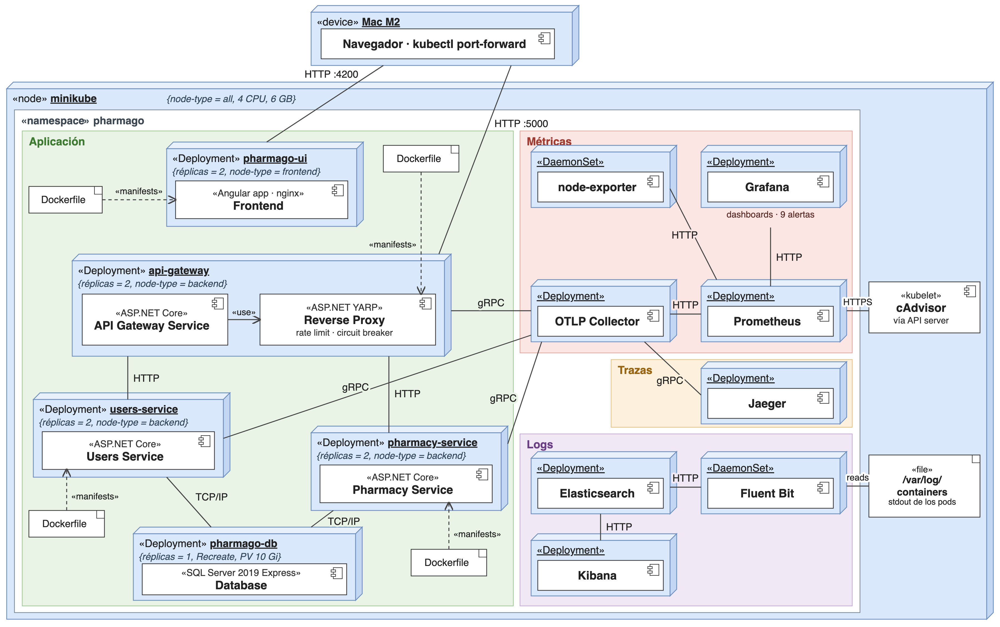
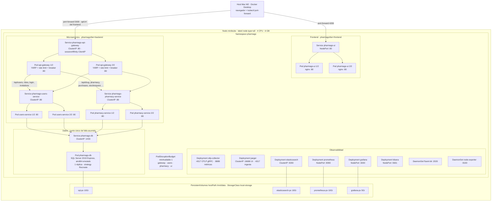
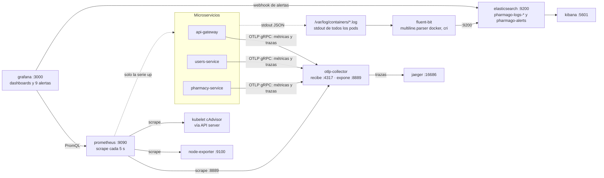
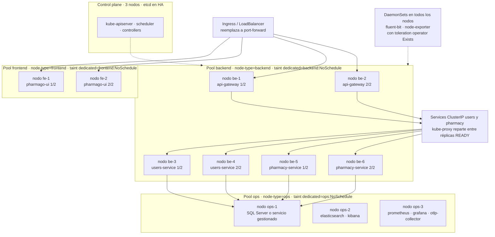

# Diagrama de despliegue de PharmaGo

El diagrama principal está en notación UML de despliegue, adaptado del diagrama inicial del docente (versión Docker Compose) a la versión final en Kubernetes. Lleva:

- nodos con componentes estereotipados;
- el `Dockerfile` de cada imagen que construimos, con su dependencia `«manifests»`;
- el protocolo de cada conexión;
- zonas por señal: métricas, trazas y logs.

La caja `«node» minikube` es la única máquina. Las cajas 3D de adentro son los Deployments y DaemonSets, que en UML también son nodos (entornos de ejecución).

Debajo, tres vistas de detalle: el despliegue actual en Minikube (un nodo), el flujo de telemetría y la topología multinodo objetivo para la que quedan preparados los manifiestos. Manifiestos en `Implementacion K8S/Codigo/k8s/`.

## 1. Despliegue actual en Minikube

Un solo nodo (driver docker, 4 CPU, 6 GB) etiquetado `node-type=all`, de modo que la `nodeAffinity` de todos los componentes se cumple en el mismo nodo. Las `podAntiAffinity` son `preferred` y no impiden el scheduling.

Notas de la vista:

- Cada microservicio corre en su propio Deployment, con un contenedor por pod y su propio Service ClusterIP. El navegador llama al gateway en `127.0.0.1:5000` (port-forward); el gateway es el único punto de entrada a la API.
- `kubectl port-forward svc/...` se ata a un solo pod: si ese pod se reemplaza, el forward se corta. Por eso la disponibilidad se mide desde dentro del clúster (`k8s/scripts/`).
- Puertos: gateway, users, pharmacy y ui escuchan en 80; SQL Server en 1433. Prometheus, Grafana y Kibana se exponen como NodePort para acceso desde el host.

## 2. Flujo de telemetría

Las métricas de la aplicación llegan solo por OTLP (el servicio de origen queda en el label `exported_job` y la réplica en `exported_instance`). Los jobs que scrapean `/metrics` a través de cada Service descartan las muestras y quedan solo para la serie `up`: con 2 réplicas, scrapear por el Service alternaba entre pods y mezclaba los contadores.

## 3. Topología multinodo objetivo

Las reglas de ubicación de los manifiestos sirven tal cual en un clúster de varios nodos: alcanza con etiquetar los nodos y aplicarles las taints. Pasar la anti-affinity a `required` convierte la separación en una garantía. Además, las imágenes locales y los volúmenes `hostPath` hay que reemplazarlos (detalle al final de esta sección).

Reglas de colocación en esa topología:

| Regla | Mecanismo | Efecto |
|---|---|---|
| Backend solo en nodos backend | `nodeAffinity` required `node-type In [backend]` + taint `dedicated=backend:NoSchedule` + toleration en los pods backend | Ningún otro pod cae en esos nodos y el backend no sale de ellos |
| Microservicios distintos en nodos físicos distintos | `podAntiAffinity` **required** con `topologyKey: kubernetes.io/hostname` y selector `pharmago/tier=backend, app NotIn [propio]` | Cumple literalmente la rúbrica |
| Réplicas de un mismo microservicio separadas | `podAntiAffinity` required (o `topologySpreadConstraints` por zona) | La caída de un nodo deja viva la otra réplica |
| Frontend y ops aislados | mismas reglas con `frontend` y `ops`: `nodeAffinity` a su pool + toleration de su taint | Un pico de Elasticsearch no le quita CPU a la API |
| Logs y métricas de nodo en todos los nodos | DaemonSets fluent-bit y node-exporter con toleration `operator: Exists` | Atraviesan las taints de los tres pools |
| Datos persistentes que sobreviven a un cambio de nodo | PersistentVolumes de red con un StorageClass con provisioner (o cada PV atado a un nodo fijo con `kubernetes.io/hostname`); para la base, una gestionada o replicada | Si la base o Prometheus se reprograman en otra máquina, encuentran sus datos |

Con separación estricta entre microservicios y entre réplicas, el pool backend necesita 6 nodos (3 microservicios x 2 réplicas). Pueden ser chicos: cada pod pide 100m de CPU y 128Mi de memoria.

Qué cambia al pasar a esa topología:

- **En el clúster, no en los manifiestos:** crear los nodos, etiquetarlos y aplicarles las taints. Las tolerations y la `nodeAffinity` de todos los componentes ya están en los YAML, así que cada componente cae en su pool sin tocar las reglas de ubicación.
- **Anti-affinity:** pasarla de `preferred` a `required` en los tres Deployments de backend. Con `preferred` el scheduler separa si puede; con `required` la separación es una garantía, que es lo que pide la letra.
- **Volúmenes:** hoy son `hostPath` (una carpeta en el disco del nodo) atados a cualquier nodo `ops`. Con un solo nodo alcanza. Con varios, un pod que cambia de máquina encuentra la carpeta vacía, así que hay que reemplazarlos por almacenamiento de red.
- **Imágenes:** las cuatro propias (UI, gateway, users y pharmacy) se cargan hoy en el nodo con `minikube image load` y usan `imagePullPolicy: Never`. Con varios nodos tienen que estar en cada uno: lo normal es publicarlas en un registry y pasar a `IfNotPresent`, lo que cambia esos cuatro Deployments.
- **Acceso:** un Ingress o un LoadBalancer en lugar de `kubectl port-forward`.
